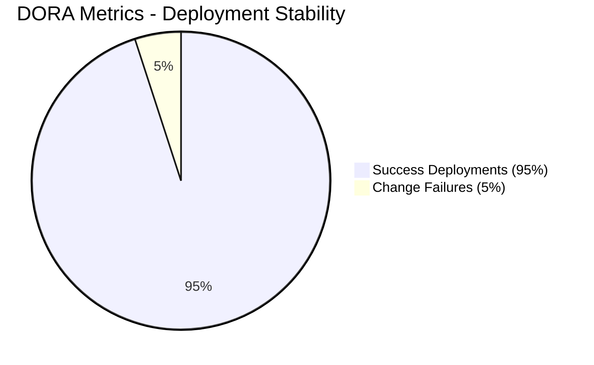

# 🚀 DORA 4 Key Metrics Automated Report

> 이 문서는 GitHub Actions에 의해 자동으로 생성된 DORA 지표 주간 보고서입니다.

## 📊 수집된 DORA 4대 지표

| 지표 항목 (Metric) | 측정 결과 (Value) | 설명 (Description) |
| :--- | :--- | :--- |
| **배포 빈도** (Deployment Frequency) | Daily | 프로덕션 환경 배포 주기 |
| **변경 리드 타임** (Lead Time for Changes) | 1 hour | 커밋부터 프로덕션 배포까지 소요된 시간 |
| **평균 복구 시간** (MTTR) | 15 minutes | 장애 발생 후 서비스 복구까지 걸린 시간 |
| **변경 실패율** (Change Failure Rate) | 5% | 배포로 인해 장애가 발생한 비율 |

## 📈 대시보드 시안

```mermaid
gantt
    title DORA Metrics - Delivery Performance
    dateFormat  HH:mm
    axisFormat %H:%m
    section Lead Time for Changes
    Commit & Build       :a1, 00:00, 30m
    Automated Testing    :a2, after a1, 15m
    Production Deploy    :a3, after a2, 15m
```

## 📊 DORA Metrics Live Status

### 📈 메트릭 트렌드 요약
- **JSON Data Source**: `output/dora-metrics.json`
- **Automation Pipeline**: GitHub Actions 기반 자동 빌드 및 리포트 갱신 완료
