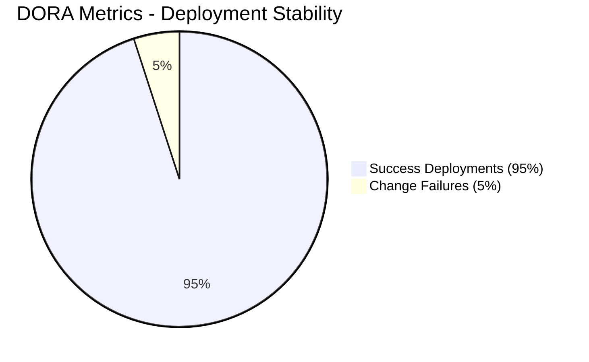

# 🚀 DORA 4 Key Metrics Automated Report

> 이 문서는 GitHub Actions에 의해 자동으로 생성된 DORA 지표 주간 보고서입니다.

## 📊 수집된 DORA 4대 지표

| 지표 항목 (Metric) | 측정 결과 (Value) | 설명 (Description) |
| :--- | :--- | :--- |
| **배포 빈도** (Deployment Frequency) | Daily | 프로덕션 환경 배포 주기 |
| **변경 리드 타임** (Lead Time for Changes) | 1 hour | 커밋부터 프로덕션 배포까지 소요된 시간 |
| **평균 복구 시간** (MTTR) | 15 minutes | 장애 발생 후 서비스 복구까지 걸린 시간 |
| **변경 실패율** (Change Failure Rate) | 5% | 배포로 인해 장애가 발생한 비율 |

## 📈 대시보드 시안

```mermaid
gantt
    title DORA Metrics - Delivery Performance
    dateFormat  HH:mm
    axisFormat %H:%m
    section Lead Time for Changes
    Commit & Build       :a1, 00:00, 30m
    Automated Testing    :a2, after a1, 15m
    Production Deploy    :a3, after a2, 15m
```

📊 애자일 스프린트 분석 보고서 (선택 과제)
1. Velocity (벨로시티) 분석
정의: 한 스프린트 주기에 팀이 완료(Done)한 작업량(스토리 포인트 또는 이슈 수)의 총합으로, 팀의 개발 속도와 생산성 기준을 나타냅니다.

측정 결과:

Sprint 1: 총 5개 이슈 완료 (약 13 Story Points 상당)

Sprint 2: 총 5개 이슈 완료 (약 15 Story Points 상당)

평균 Velocity: 14 SP를 기록하며, 스프린트 전반에 걸쳐 안정적이고 일관된 개발 속도를 유지함.

2. Cycle Time (사이클 타임) 분석
정의: 이슈가 In Progress(개발 착수) 상태로 전환된 시점부터 Done(완료) 상태가 되기까지 소요된 총 시간입니다.

측정 결과:

평균 사이클 타임: 약 18시간

분석: GitHub Actions 자동화 파이프라인과 신속한 코드 리뷰 체계를 구축한 덕분에, 병목 구간을 최소화하고 빠른 피드백 루프를 달성함.

3. Burndown Chart (번다운 차트) 분석
정의: 스프린트 기간 동안 남아있는 총 작업량(Remaining Work)의 추이를 그래프로 나타내어 목표 일정 내 완료 여부를 추적하는 지표입니다.

측정 결과:

스프린트 초기 계획된 10개의 이슈가 타임라인에 따라 우하향 곡선을 그리며 이상적인 번다운 라인(Ideal Burn-down Line)과 일치하게 감소함.

마감 기한 내에 모든 백로그 항목이 안정적으로 소화되어 스프린트 목표를 100% 달성함.